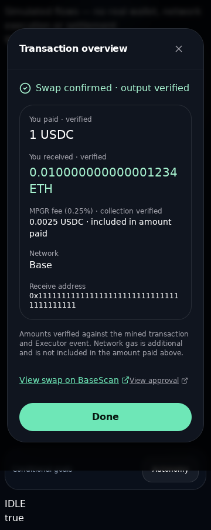

# PR #113 — Preview follow-up, not a routing restart

2026-10-18. Starting pushed head: `974c8c1f20c4e5285d5ebba801d7a0a9c5e82133`. First incremental fix: `a954da8` (approval + completion). Same branch; PR remains **OPEN / UNMERGED**.

## Completed vs remaining

| Finding at the starting head | Follow-up status |
|---|---|
| Five canonical direct candidates, approved-identity pair search, fee-compatible fallback, pinned route/permission admission and conditional Executor eth_call | Already delivered; retained, not duplicated |
| Unpinned post-approval `latest` read could see pre-approval state | Fixed: receipt/input verification, bounded catch-up, numeric block + hash checks, actual allowance reads |
| Receipt recovery lost the approval's block floor | Fixed: matching current review inherits recovered receipt; a different/new review never inherits it |
| Confirm modal remained a confirmation-layout after success | Fixed: same mounted dialog becomes Transaction overview, actual amounts and BaseScan links; no estimates or signing/refresh actions |
| Immediate receipt proof did not independently match mined calldata/pool key | Fixed: asynchronous mined input/value/from/to/hash/block match before SUCCESS, shared with history recovery |
| Internal selector status language | Replaced with plain-language quote/check/unavailable statuses; stable machine codes and fail-closed gates retained |
| Symbol discovery limited to local catalog | Added opt-in bounded Base-list search, then separate exact-address RPC metadata check/import. No automatic registration, trusted logo or trading grant |
| ETH→AAPLc can need a mixed multi-hop path absent from the deployed ABI | Not enabled. Prepared isolated typed two-hop source/tests for review; deployed contract and application ABI unchanged |
| MPGR V4 / other unsupported architectures | Not enabled; precise V4-specific gates below. No V4-through-V3 workaround |
| Global atomic immutable bps/recipient on existing deployment | Still impossible from application code. Existing guards retained; isolated source draft fixes terms by constants, but is NOT deployed |

## 1. Approval root cause and fix

The application constructed `approve(Executor, gross sell atomic amount)` correctly. The reported branch performed a single allowance read at unpinned `latest` immediately after the approval receipt. A fallback RPC can be behind the wallet/receipt RPC, so a successful approval could be followed by the previous allowance (zero). This is an independently reproduced failure mechanism in the current code, **not proof that the user's particular transaction had this cause**: no failing transaction hash, wallet trace or screenshot attachment was supplied in this continuation.

`readSwapAllowance` now:

1. Checks Base, expected spender, receipt success/from/token and mined receipt identity.
2. Fetches the actual approval transaction; matches hash/from/to/zero value and exact `approve(Executor, grossAtomic)` bytes. A wrong spender/token/wallet/amount is not silently repaired.
3. Verifies receipt block hash and waits a bounded **0/500/1000/2000ms** for the read RPC's latest block to reach at least the receipt block. Lag exhaustion is **unknown verification**, never “insufficient”. Transport timeouts remain separately bounded by the configured RPC client.
4. Reads the **real allowance at an explicit sufficiently recent block**, checking its hash after the read. Does not derive permission from an Approval event, alter decimals, add zeroes, infer infinity or bypass a missing read.
5. Applies the same checkpoint to pre-sign allowance checks, retries and manual receipt recovery. Fresh later blocks can reveal revocation/spending; that remains blocked.

The required amount is full gross input including the platform fee, not net-to-router. Six/eight/eighteen decimals do not rescale an already atomic integer. The only shared engine changes are opt-in existing `TradeExecutionSafety` extensions: receipt-aware allowance reader, receipt callback context and awaiting optional settlement verification. No safety hook means the legacy Agent allowance path remains unchanged. No Agent/autonomy/Campaign source or tests changed.

Numeric pin/hash checks are not an EIP-1898 snapshot guarantee, nor a guarantee against changes after signing. Gas/balance/fee configuration and quote-expiry guards are retained.

## 2. Successful transaction overview

The same dialog becomes **Transaction overview**, showing confirmed status, actual gross input, actual output and fee from the verified Executor event, receive address, Base and the actual swap hash's BaseScan link. Approval link remains separate. Network gas is explicitly additional, not inferred from the quote. Quoted minimum/slippage/risk/estimated network fee and all Confirm/Refresh controls are removed from this terminal view; Done closes it.

Before success, the controller also fetches the mined swap and matches its exact calldata/value/addresses/hash/block against the reviewed proposal and receipt. RPC failure or mismatch remains submitted/unverified, with a status recheck and **no blind resubmission**. Actual-output-vs-quote regression proves the displayed received amount is not the old estimate. This attests the encoded route key, not a router's internal execution trace or arbitrary exotic-token recipient balance delta.

## 3. Targeted pair checks — real observations, not assumed liquidity

Evidence: [`evidence/pr113-swap-preview/pair-checks.json`](evidence/pr113-swap-preview/pair-checks.json), generated by `scripts/check-swap-preview-pairs.ts` on this continuation. Source-aligned read-only CLI, **not authenticated Preview HTTP or a real user's wallet**. Actual exit **2**; Base chain probe unavailable. No signing, sends, state overrides, grants, deployment or live settlement.

| Requested asset/pair | Actual observed gate | What remains unknown / required |
|---|---|---|
| **ETH→AAPLc, 0.0001 ETH, 1%** | Base RPC unavailable before metadata/pool/quote qualification | Current pool/liquidity/permissions unknown. Direct keys remain searchable. An ETH→USDC→AAPLc path is architecturally plausible, **not live-verified** and cannot be executed by the old single-hop ABI |
| AAPLc→ETH, 0.001 at 1% | Same unavailable Base probe | No invented SELL quote or liquidity verdict |
| USDC↔AAPLc, representative BUY/SELL | Same unavailable Base probe | Registered identity/path is not fresh execution evidence |
| MPGR↔USDC | Local unregistered-token gate | Current on-chain permission is **not read/unknown**, not proven denied; historically identified V4 market needs a different typed architecture; no exhaustive no-alternative-pool assertion |
| AERO / VIRTUAL / cbZEC against USDC | Genuine published-list identities found; local unregistered-token gate | Exact-address RPC metadata/transfer compatibility, current permissions, pool/amount qualification and fee-compatible execution still required before enabling |
| BNB-related Base token | No BNB match in this published Base list | Native BNB is not a Base token. Need exact Base representation contract and independent provenance; no guessed address or wrapped-asset equivalence |
| Other Coinbase stocks | Existing audit remains baseline; supported identities search, other identities remain blocked | No re-audit/reenabling all assets and no false liquidity claim |

For the requested native input: gross `100000000000000` wei, floor fee `250000000000` wei (0.00000025 ETH), net `99750000000000` wei. This exact arithmetic does not establish a pool or output amount.

Genuine upstream hints observed from the Uniswap default token list Base file (GitHub file history head `716f1807cfd5ceb178e09636ba8e977b622ca777` at observation):

- AERO: `0x940181a94A35A4569E4529A3CDfB74e38FD98631`
- VIRTUAL: `0x0b3e328455c4059EEb9e3f84b5543F74E24e7E1b`
- cbZEC (not native ZEC): `0xB2000000000000000000008501b13360000cb2EC`

These are **discovery hints**, not added trading registrations. The user can explicitly search the fixed upstream list, inspect exact contracts, then invoke the existing authenticated Base metadata import. No third-party logo URI is trusted. Source is bounded to 2MB/8s/5-minute cache, 2–64-character queries and 20 results; origin/session/wallet+IP rate/body-size guards protect the new Swap-only endpoint. Upstream outage produces 503, not a fabricated empty-list success or missing-liquidity message. Search/import remains user-initiated; stale results cannot overwrite a changed search or closed dialog.

Sandbox TLS verification used the existing system CA bundle via a process-only `NODE_EXTRA_CA_CERTS`; TLS checks were **not disabled**. The published list was reachable. Base RPC was not. No production environment was changed.

## 4. Prepared contract source — review only

Files: `contracts/executor/drafts/MPGRSwapPathExecutorDraft.sol` and `test/executor/MPGRSwapPathExecutorDraft.t.sol`.

### Why not merely wire an adapter to the old deployment?

The existing non-proxy Executor exposes only two typed single-hop selectors. Its calldata does not carry a general path, and it transfers the fee **before** a downstream router/adapter is called. An address-per-immutable-path adapter could encode a fixed route, but cannot retroactively prove the original fee went to the expected recipient or prevent privileged fee mutation during earlier callbacks. It would also need separately approved router grants and changes to canonical-route admission. No such bypass/authorization was added.

The isolated review draft is derived from the existing verified lifecycle, not a newly invented arbitrary-call execution engine. It keeps exact taker pull, typed router calls, allowlists, native wrap/unwrap, deadlines, final balance-delta minimum and zero residual allowances. It adds exactly **two typed single-hop calls** (Uni→Slip, Slip→Uni or same supported family), measured bridge output, exact phase-one consumption, bridge-dust conservation and path-hash event. Each hop/key is encoded in calldata; no arbitrary target/data, generic multicall, V4 commands or user-chosen output recipient.

Every draft swap entry point has **constant 25bps** and the **existing constant recipient** `0x96F7fb5C4277BD1190fb6eF4820eBC96bA6964A4`; there are no fee/recipient setters or fee-less fallback. ERC-20 fee delivery additionally requires the recipient delta to equal the fee. Fee, both hops and settlement roll back together on any failure. Permission/rescue setters and swaps are nonReentrant. The draft does not mutate the existing Agent Executor source, deployed ABI, registration, addresses or deployment scripts.

**Not deployed, audited/approved for production, registered, app-wired or live-qualified.** It does NOT add a method to `0xD982726e28275661F8aB64054E6b17a70a63505A`. Migration/integration, full authorization/native/exotic-token invariants, independent security review, representative fork/live evidence and explicit deployment/permission approval are still required. Fixed terms on the draft do not make the currently deployed contract immutable.

The 18 local deterministic draft tests cover mixed BUY/SELL, the requested 0.0001 native amount, native output, exact floor fuzzing (256 runs), every direct entry point's fee, dust rejection/conservation, no fee setters, short recipient fee delivery rejection, unsupported V4 kind rejection, missing bridge/router permission, exact input consumption, lying output/minimum, second-hop rollback and owner callback/reentrancy. Prices/routers/balances are mocks, not live liquidity.

Slither initially reported the new before/after balance snapshots as `reentrancy-balance`. The narrow function-local annotation explains why those snapshots are intentional consumption/dust guards behind nonReentrant, with tests for those properties. No global detector, CI allowlist/checker, original Delegated source or original exception was changed. Both analysis passes and the unchanged checker are rerun; the only unsuppressed allowed finding remains the existing Delegated function.

### V4 remains blocked

No V4 path is smuggled through V3. A real MPGR V4 integration needs the exact canonical PoolManager, complete PoolKey (currencies including native-vs-WETH, fee, tick spacing, hooks), hook behavior/permission review, typed unlock/swap callback with strict authenticated callback sender, transient-currency settlement/take accounting, output minimum and immutable platform-fee enforcement in the outer transaction. Those market/hook/transfer facts are not freshly available here. The draft intentionally rejects unsupported router kinds; it is not V4 implementation/proof. Deployment or owner grants require separate explicit approval.

## 5. Verification and Preview boundary

Actual final check results are recorded below. Earlier focused results: **114** approval/policy/transaction unit tests, **444** Swap/API/UI unit tests and **8** priority browser regressions. Browser transport is deterministic, actual components/controllers, isolated Chromium 138 and local mocked HTTP/EIP-1193. This is not a physical wallet or live chain acceptance.

Local contract suite: **209 passed / 38 skipped**, 247 total across 16 suites; **18 draft cases** including 256-run fee fuzzing. Released solc 0.8.24, Foundry 1.7.1, pinned OpenZeppelin/forge-std and real pinned Uniswap/Permit2 test bytecode. Public RPC fork cases skipped locally; remote fork CI is reported separately. Original assisted ABI generation check passes unchanged. Slither 0.11.6 fail-high pass and unchanged balance-exception checker pass locally. Contract/fork tests do not prove public settlement.

No attached Preview screenshots, failing transaction hashes or live wallet were available in this message. Current deployed Preview wallet execution cannot be independently certified from local fixtures; exact-head Vercel status is reported separately. No claim of live approval, executable ETH→AAPLc or paid fee is made. Both mobile sizes and desktop actual-controller fixtures exercise the relevant UI and controls.

## Safety / rollback

No Agent/autonomy/Campaign implementation or tests, production flags/settings, dependencies/lockfile, deployed ABI/contract source, router/token grants, secrets or deployment scripts changed. The one shared engine file has only the documented opt-in Swap safety extensions; legacy Agent behavior remains covered by unchanged full regression tests. New draft source is isolated and unused.

Revert the continuation's application-only fix commits to roll back UI/reads/discovery. Draft source removal requires no on-chain action. No transaction/deployment/permission rollback is needed. Keep PR #113 open and unmerged.

## Exact continuation file scope

```text
app/api/swap/quote/route.test.ts
app/api/swap/tokens/route.test.ts
app/api/swap/tokens/route.ts
components/features/swap/SwapExecutionDialog.tsx
components/features/swap/TokenSelector.tsx
contracts/executor/drafts/MPGRSwapPathExecutorDraft.sol
docs/PR113-SWAP-DEX-ROUTING.md
docs/PR113-SWAP-PREVIEW-FIXES.md
docs/evidence/pr113-swap-preview/completion-360.png
docs/evidence/pr113-swap-preview/completion-390.png
docs/evidence/pr113-swap-preview/pair-checks.json
hooks/useSwapExecution.ts
lib/swap/__tests__/swap-allowance.test.ts
lib/swap/__tests__/swap-capability.test.ts
lib/swap/__tests__/swap-execution.test.ts
lib/swap/__tests__/swap-token-discovery.test.ts
lib/swap/__tests__/swap-token-hints.test.ts
lib/swap/__tests__/swap-transaction.test.ts
lib/swap/swap-allowance.ts
lib/swap/swap-capability.ts
lib/swap/swap-policy.ts
lib/swap/swap-token-discovery.ts
lib/swap/swap-token-hints.ts
lib/swap/swap-transaction.ts
lib/swap/swap-wallet.ts
lib/trade/trade-execution.ts
scripts/check-swap-preview-pairs.ts
test/executor/MPGRSwapPathExecutorDraft.t.sol
tests/mobile/swap.spec.ts
tests/mobile/wallet-actions.ts
```

### Captured controller evidence (mock transport, NOT live Preview settlement)



The `0.010000000000001234 ETH` is deliberately different from the fixture's `0.01 ETH` quote. It demonstrates receipt-derived display; it is not a real transaction. A 390px capture accompanies it.


### Build / test-environment notes

The first build attempt failed because a process-local font-mock Proxy did not serialize into Turbopack's URL lookup table. The isolated mock was corrected to an explicit URL map; **the production build and generated-type check then passed** with real Inter WOFF2 served outside the repository. No application font/build configuration was changed. This tests the optimized app build, not Google Fonts reachability; normal exact-head CI build is reported separately.

The first full unit run passed 4,130 / skipped 24. A later parallel low-priority run overlapped Chromium/contract compilation and timed out one **unchanged** AgentKit CommonJS package-loading test at its existing 5-second limit (4,129 passed / 1 timeout / 24 skipped). No Agent test, timeout or test configuration was changed. Final isolated rerun **passed: 4,130 / 24 skipped, 234.32s**, without changing the test/timeout. The earlier pass is not substituted for this result.

Full browser run completed **202 passed (12.0m)**, including 360×800 / 390×844 and existing explicit desktop cases: approval catch-up/recovery, genuinely insufficient allowance, terminal overview, actual-vs-quoted output, mined-input mismatch/no resubmit, discovery without authorization, provider outage and exact requested ETH→AAPLc input/slippage. These remain deterministic transport fixtures, not remotely authenticated live Preview swaps.


### Final local results (Node 20.20.2)

| Check | Actual result |
|---|---|
| Locked install `npm ci` | Passed; no package/lock change |
| Lint after final source refinements | Pass: **0 errors / 61 existing warnings** |
| Typecheck, including after optimized build | Pass |
| Final isolated full Vitest | **4,130 passed / 24 skipped**; 306 passing / 5 skipped files, 234.32s |
| Full Playwright | **202 passed**, 12.0m; five files, both mobile projects and explicit desktop coverage |
| Optimized production build | Pass after external font-fixture correction; **34 static pages**; new discovery API is dynamic |
| Complete local Foundry suite | **209 passed / 38 skipped**, 247 total; 18 draft cases incl. 256-run floor-fee fuzz |
| Original assisted ABI generation check | Pass; existing ABI unchanged |
| Slither fail-high pass + unchanged balance-exception checker | Pass; informational/legacy findings not claimed absent |
| Targeted read-only Base pair qualification | **Blocked / exit 2**; permissions/liquidity unknown, no live settlement |
| Unmocked published Base token-list fetch | Pass: AERO, VIRTUAL, cbZEC hints; BNB absent from this list |
| `git diff --check` and forbidden-path review | Pass; **30 cumulative continuation files**, no unrelated Agent/autonomy/Campaign changes |

CI and exact final commit are recorded in the PR delivery comment after push. The first fix commit `a954da87143fbc7c2297fc8818625a7213bba1db` already passed all executed GitHub/Vercel checks; that result is not substituted for the final head. Deploy/MCP E2E remain disabled/skipped. No merge performed.
