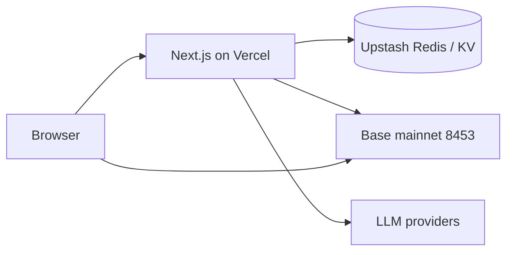
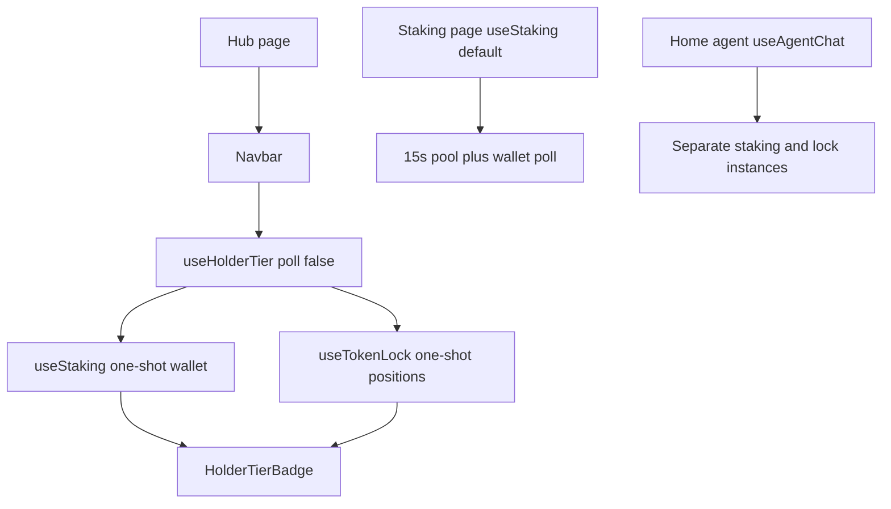
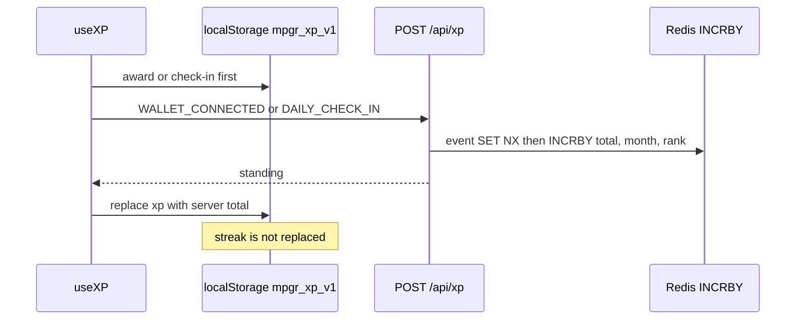

# Current architecture and data flow

The browser talks to Base directly for wallet reads and for every signature. The server talks to Base for quotes, discovery, and settlement verification. The server does not hold the user's key. Operator broadcasters exist behind explicit gates and are out of scope for this audit's code change.

Before this branch, `tier` used the default poll, so every Navbar mount also started the 15s timers and, even logged out, one `getGlobalState`. Snapshot mode still loads a connected wallet once. On `staking_changed` it reloads that wallet and does not call `getGlobalState` unless `poll` is true. PR #145's asset changes are not on this diagram.

## XP

Game runs add a second path: `RunGame` may grant local capped XP and, separately, `POST /api/games/mpgr-run/reward` grants server XP only after replay. The reward route does not accept a client XP number. `GAME_REWARDS_ENABLED` defaults off for token settlement. Production flag values are **unknown**.

## Auth

`GET /api/auth/nonce` sets a single-use nonce. `POST /api/auth/verify` checks the SIWE signature and stores `mpgrhub:auth:session:{id}`. Later routes read the HMAC cookie, then Redis. `protectApiRequest` checks origin, body size, and rate limit. It does not itself load the session. Missing Redis fails closed (503 on the limiter).

## Single points of failure

| Piece | Why it hurts | Evidence |
| --- | --- | --- |
| `components/providers.tsx` | Every page shares one wagmi + RainbowKit + React Query tree | `app/layout.tsx` |
| `getRedis()` | Sessions, XP, referrals, campaigns, game runs, rate limits | `lib/api/redis.ts` |
| Browser RPC list | One transport, public fallback | `lib/wagmi.ts`, `lib/chain/rpc-endpoints.ts` |
| `XP_ACTIONS` | Every grant amount | `lib/xp-engine.ts` |
| Sealed swap v2 manifest | Executable v2 quotes depend on it | `app/api/swap/v2/quote/route.ts` |
| `CRON_SECRET` | Settlement, reconcile, campaign admin, autonomy tick | route files; unset fails closed |

React Query is mounted for wagmi. Product data does not go through it. That is why each hook polls on its own.
